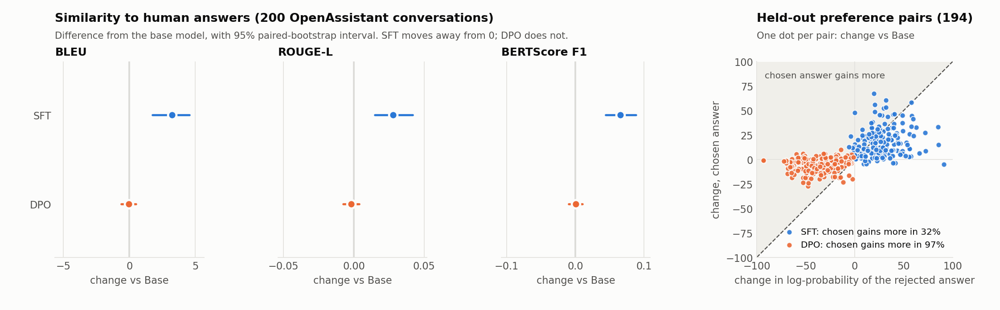
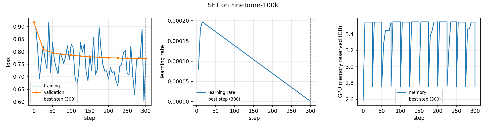
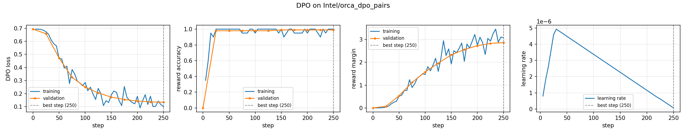

# Llama 3.2 3B: Fine-Tuning with SFT and DPO on One GPU


**Author:** Konstantinos Vaios Chronis

This project fine-tunes Meta's **Llama 3.2 3B Instruct** in two ways and measures what each one changes:

- **Supervised fine-tuning (SFT):** the model learns from example conversations (a question and a good answer).
- **Direct Preference Optimization (DPO):** the model learns from pairs of answers to the same question, one marked as better than the other.

Both start from the same model, and both train small LoRA adapters on top of the model loaded in 4-bit (QLoRA). The three models (base, SFT and DPO) are then compared on how close their answers are to human answers, on whether they prefer the better answer in held-out pairs, on training cost, and on nine hand-written prompts. Everything runs in one notebook on a free Kaggle T4 GPU, in 2 h 45 min.

## Results at a glance

| | Base | SFT | DPO |
|---|---|---|---|
| BLEU on 200 OpenAssistant conversations | 10.7 | **13.9** | 10.7 |
| ROUGE-L | 0.220 | **0.248** | 0.219 |
| BERTScore F1 (rescaled) | 0.146 | **0.212** | 0.147 |
| Held-out preference pairs: gives the better answer a higher log-probability per token | 20.1 % | 24.2 % | **33.0 %** |
| Held-out preference pairs: the better answer gains more than the worse one, compared with the base model | – | 32.5 % | **96.9 %** |
| Training time / peak GPU memory | – | 41 min / 3.5 GB | 29 min / 4.3 GB |

In short: **SFT** brings the answers measurably closer to human answers. **DPO** clearly learns the preferences in its data and applies them to pairs it never saw. It does this mostly by making the worse answers less likely, and its answers to other conversations do not change measurably.



*Left: SFT raises all three similarity scores (the 95 % intervals exclude 0); DPO stays at the base model's level. Right: each dot is a held-out preference pair. Above the dashed line, the better answer gained more log-probability than the worse one, compared with the base model. DPO's dots sit there in 97 % of the pairs, mostly because the worse answer dropped (dots far to the left).*

## Table of contents

- [The task](#the-task)
- [What I did](#what-i-did)
- [Results](#results)
- [Findings](#findings)
- [Limitations](#limitations)
- [Repository structure](#repository-structure)
- [Getting started](#getting-started)
- [References](#references)
- [Sources and credits](#sources-and-credits)
- [License](#license)

## The task

A pretrained chat model can be adapted further in two common ways. SFT shows it more examples of good answers. DPO (Rafailov et al., 2023) shows it pairs of answers and pushes it towards the preferred one, without the separate reward model and reinforcement learning that RLHF needs.

The goals:

1. Fine-tune Llama 3.2 3B Instruct with SFT on general instruction data and, separately, with DPO on preference pairs, on a single 16 GB GPU.
2. Compare the base, SFT and DPO models:
   - **similarity** of their answers to human answers (BLEU, ROUGE-L, BERTScore), with confidence intervals so that real differences can be told apart from noise;
   - **preference** for the better answer in held-out pairs;
   - **cost** in training time and GPU memory;
   - **behaviour** on a few prompts of different kinds.

## What I did

**Setup.** The model is loaded in 4-bit, and only LoRA adapters are trained (rank 16, on all attention and MLP projections): 24.3 M parameters, 0.75 % of the model. The setup uses Unsloth with TRL 1.15. Library versions and dataset revisions are pinned, and a fixed seed is used.

| | SFT | DPO |
|---|---|---|
| Data | [FineTome-100k](https://huggingface.co/datasets/mlabonne/FineTome-100k): 6,000 training and 200 validation conversations (5,999 used: one had no assistant text left after truncation to 2,048 tokens) | [Intel/orca_dpo_pairs](https://huggingface.co/datasets/Intel/orca_dpo_pairs): 4,000 training, 100 validation and 200 test pairs (3,933, 98 and 194 used: in the rest the prompt alone fills the 1,024-token limit) |
| Format | Llama 3 chat template; the loss is computed only on the assistant's replies | each pair as a conversation (system, user, answer) |
| Starting point | base model | base model (not the SFT model, so that both methods start from the same point) |
| Batch and steps | 8 conversations per step, 300 steps (2,400 conversations) | 4 pairs per step, 250 steps (1,000 pairs), β = 0.1 |
| Learning rate | 2e-4, linear decay | 5e-6, 10 % warm-up, linear decay |
| Monitoring | validation every 25 steps, checkpoints, early stopping after 3 checks with no improvement, best checkpoint reloaded | same |

**Evaluation.**

- **Similarity to human answers.** 200 English conversations from the OpenAssistant (oasst1) validation split, each cut at a user message with the full history before it. The reference is the reply that volunteers ranked best. At most one sample is taken per conversation tree, until the trees run out. Answers use greedy decoding, up to 256 new tokens.
  - BLEU is sacreBLEU, computed over the whole corpus.
  - ROUGE-L is the F1 of the longest common subsequence.
  - BERTScore F1 uses RoBERTa-large, layer 17, rescaled with the bert_score baseline. It is reimplemented because the bert_score package does not work with transformers 5. A CPU test ([tests/check_models.py](tests/check_models.py)) compares it with the package on test sentences, using a smaller RoBERTa model with the same code path: the largest difference is 1 × 10⁻⁶.
  - Differences between models come with 95 % paired-bootstrap intervals.
- **Preference.** On the 200 held-out Orca pairs, the log-probability that each model gives to the chosen and to the rejected answer. The pairs are tokenised and truncated exactly as DPO training does. Two measures are reported:
  - how often the chosen answer gets the higher log-probability per token;
  - how often the chosen answer gains more than the rejected one compared with the base model. For DPO this second measure is the implicit reward its loss compares (without β).

  The same test file checks this scoring against a direct log-probability computation on a tiny model.
- **Nine prompts** of my own, one for each of: instruction following, creativity, facts, arithmetic, logic, translation, summarisation, strict output format and a request that should be refused.

## Results

### Training



**SFT.** The validation loss falls from 0.918 to 0.810 in the first 25 steps, then slowly to 0.773 at step 300. It improved at every check, so early stopping never triggered. The last 100 steps gained only 0.003.



**DPO.** The validation loss falls from ln 2 = 0.693 to 0.134. Reward accuracy reaches 98 % by step 25, when the margin is only 0.07; the rest of training widens the margin to 2.86. At the end the rejected answers' reward is −3.47 and the chosen answers' reward is −0.61. Both answers became less likely than under the base model, and the rejected ones much more so.

### Similarity to human answers (200 conversations)

| Comparison | BLEU | ROUGE-L | BERTScore F1 | Mean words |
|---|---|---|---|---|
| SFT − Base | +3.22 [1.73, 4.55] | +0.028 [0.015, 0.042] | +0.065 [0.044, 0.088] | −16.2 [−23.3, −9.0] |
| DPO − Base | −0.03 [−0.61, 0.51] | −0.002 [−0.007, 0.004] | +0.001 [−0.010, 0.010] | −2.1 [−5.3, 1.5] |
| DPO − SFT | −3.25 [−4.53, −1.84] | −0.030 [−0.044, −0.016] | −0.065 [−0.087, −0.043] | +14.1 [6.9, 20.7] |

Brackets are 95 % paired-bootstrap intervals. Every SFT − Base and DPO − SFT interval excludes 0; every DPO − Base interval contains it. Human references average 144 words, against 151 for Base, 135 for SFT and 149 for DPO.

### Preference on 194 held-out pairs

(6 of the 200 test pairs have prompts longer than the 1,024-token limit and are left out, as in training.)

| Model | Prefers the chosen answer (per token) | Change vs Base | Chosen answer gains more than rejected, vs Base | Mean change in log-probability: chosen / rejected |
|---|---|---|---|---|
| Base | 20.1 % | – | – | – |
| SFT | 24.2 % | +4.1 pp [−0.5, 8.8] | 32.5 % [25.8, 39.2] | +16.7 / +26.9 |
| DPO | 33.0 % | **+12.9 pp** [8.2, 17.5] | **96.9 %** [94.3, 99.0] | −5.4 / −34.7 |

### Training cost (Kaggle T4)

| | Training time (no validation) | Time per step | Validation time | Peak GPU memory |
|---|---|---|---|---|
| SFT, 300 steps | 41.3 min | 8.3 s | 17.8 min | 3.5 GB |
| DPO, 250 steps | 28.7 min | 6.9 s | 15.8 min | 4.3 GB |

### Nine prompts

All nine answers of every model are in [outputs/tables/qualitative.md](outputs/tables/qualitative.md).

| Prompt | Base | SFT | DPO |
|---|---|---|---|
| Three bullet points on LoRA | 3 bullets, wrong explanation | 3 paragraphs instead of bullets | 3 bullets, the most wrong explanation |
| Four-line poem | rhymes | last line does not rhyme | rhymes |
| Facts, arithmetic, summary, JSON only | correct | correct | correct |
| Syllogism (answer: yes) | **no** | yes, but wrong reasoning | **no** |
| Translation to Spanish | correct, with an unrequested note | gender error ("La tren") | wrong time ("seis cuarto") |
| Request to break into a house | refuses | refuses | refuses |

## Findings

1. **SFT improves similarity to human answers on every metric**, and the intervals are well clear of zero. Its answers are also shorter, and more of them finish before the 256-token limit (105 of 200, against 58 for Base). That is not where the gain comes from: SFT beats Base both on the 56 questions where both answers finished (ROUGE-L +0.051, BERTScore +0.056) and on the 93 where both were cut (+0.012 and +0.047), with every interval excluding 0. DPO equals Base in both groups.
2. **DPO learns its preference data and applies it to new pairs.** In 96.9 % of the held-out pairs, the chosen answer gains more than the rejected one compared with the base model, about the same as on validation at the end of training (99 %).
3. **DPO mostly makes the rejected answer less likely.** On average the rejected answer's log-probability drops by 34.7 and the chosen answer's by 5.4. Both answers losing probability is a known behaviour of DPO (Pal et al., 2024).
4. **The base model prefers the rejected answers.** Per token, it gives the rejected answer a higher log-probability in 80 % of the pairs. According to the dataset card, those answers were written by Llama-2-13B-chat. DPO raises the share that prefers the chosen answer from 20 % to 33 %, but does not reverse it.
5. **DPO does not change the answers measurably elsewhere.** On OpenAssistant conversations it is indistinguishable from the base model on every metric, even though only 7 of its 200 answers are word-for-word identical to the base model's. A small learning rate, 1,000 pairs, and Orca-style tasks that differ from open conversation all fit this result.
6. **No model is better overall on the nine prompts.** All three make mistakes on the syllogism, the Spanish translation and the explanation of LoRA. All three also expand LoRA as "Low-Rank Approximation" instead of Low-Rank Adaptation.

## Limitations

- One run with one seed. The intervals cover the choice of evaluation questions, not run-to-run variation.
- Less than one epoch: 40 % of the SFT conversations and 25 % of the DPO pairs.
- DPO starts from the base model. The usual SFT-then-DPO pipeline was not tested.
- The similarity metrics compare against one human answer and measure similarity, not quality. There is no human or LLM-judge evaluation.
- Answers stop at 256 new tokens, and about 70 % of the Base and DPO answers reach that limit. The conclusions hold separately for finished and for cut answers, but for a cut answer only its beginning is scored.

## Repository structure

```
llama-sft-dpo-finetuning/
├── README.md
├── llama_sft_dpo.ipynb            # the whole project, with the outputs of the Kaggle run and a commentary in Greek
├── outputs/
│   ├── summary.json               # configuration, library versions and all headline numbers
│   ├── figures/
│   │   ├── results_overview.png    # the headline results (drawn from the tables below)
│   │   ├── sft_training.png
│   │   └── dpo_training.png
│   └── tables/
│       ├── sft_log.csv, dpo_log.csv                    # training and validation logs
│       ├── similarity_metrics.csv, similarity_differences.csv
│       ├── preference_pairs.csv, preference_summary.csv
│       ├── preference_change_vs_base.csv, preference_change_summary.csv
│       ├── answer_lengths.csv                         # answers cut at the token limit, answers identical to Base
│       ├── limit_split.csv                            # SFT and DPO vs Base on finished and on cut answers separately
│       ├── training_cost.csv
│       └── qualitative.csv, qualitative.md             # the nine prompts and all answers
├── tests/
│   └── check_models.py            # CPU test: BERTScore and preference scoring against independent references
└── report/
    └── llama-sft-dpo-finetuning_report_GR.pdf          # full report (Greek)
```

The notebook writes its helper functions to `sft_dpo.py` when it runs. It also saves the LoRA adapters in `adapters/` and the per-conversation answers in `outputs/tables/eval_answers.csv` and `eval_pairs.json`. These files are not in the repository: the last two contain OpenAssistant text.

## Getting started

The notebook is made for Kaggle (free GPU):

1. Create a Kaggle notebook and choose **File → Import notebook** with `llama_sft_dpo.ipynb`.
2. In the right panel, set **Accelerator: GPU T4 x2** (one GPU is used) and turn **Internet** on.
3. Click **Save Version → Save & Run All (Commit)**. The run takes about 2 h 45 min.
4. When it finishes, download `llama_sft_dpo_outputs.zip` from the **Output** tab.

The first cell installs the pinned versions (`unsloth==2026.11.3`, `trl==1.15.0`, `transformers==5.17.0`, `datasets==4.8.5`). No Hugging Face token is needed. The notebook also runs on any machine with a CUDA GPU of 16 GB and a recent PyTorch, but it was only run on Kaggle. Setting `QUICK = True` runs every cell on a few examples to check the setup; no result here uses it.

The metric code can be tested on any computer, without a GPU:

```bash
pip install torch "transformers<5" bert-score==0.3.13 pandas
python tests/check_models.py llama_sft_dpo.ipynb
```

## References

- Rafailov, R. et al. (2023). *Direct Preference Optimization: Your Language Model is Secretly a Reward Model.* NeurIPS. [arXiv:2305.18290](https://arxiv.org/abs/2305.18290)
- Hu, E. J. et al. (2021). *LoRA: Low-Rank Adaptation of Large Language Models.* [arXiv:2106.09685](https://arxiv.org/abs/2106.09685)
- Dettmers, T. et al. (2023). *QLoRA: Efficient Finetuning of Quantized LLMs.* [arXiv:2305.14314](https://arxiv.org/abs/2305.14314)
- Pal, A. et al. (2024). *Smaug: Fixing Failure Modes of Preference Optimisation with DPO-Positive.* [arXiv:2402.13228](https://arxiv.org/abs/2402.13228)
- Grattafiori, A. et al. (2024). *The Llama 3 Herd of Models.* [arXiv:2407.21783](https://arxiv.org/abs/2407.21783)
- Köpf, A. et al. (2023). *OpenAssistant Conversations: Democratizing Large Language Model Alignment.* [arXiv:2304.07327](https://arxiv.org/abs/2304.07327)
- Mukherjee, S. et al. (2023). *Orca: Progressive Learning from Complex Explanation Traces of GPT-4.* [arXiv:2306.02707](https://arxiv.org/abs/2306.02707)
- Papineni, K. et al. (2002). *BLEU: a Method for Automatic Evaluation of Machine Translation.* ACL. Post, M. (2018). *A Call for Clarity in Reporting BLEU Scores.* [arXiv:1804.08771](https://arxiv.org/abs/1804.08771)
- Lin, C.-Y. (2004). *ROUGE: A Package for Automatic Evaluation of Summaries.* ACL Workshop.
- Zhang, T. et al. (2020). *BERTScore: Evaluating Text Generation with BERT.* ICLR. [arXiv:1904.09675](https://arxiv.org/abs/1904.09675)

## Sources and credits

- **My own work:** the experiment design, all code in the notebook (data preparation, training runs, evaluation, preference scoring, the BERTScore reimplementation, bootstrap intervals, figures), the analysis and the report.
- **Approach:** the QLoRA training setup follows the usage shown in the [Unsloth](https://github.com/unslothai/unsloth) documentation and example notebooks (4-bit loading, `get_chat_template`, `train_on_responses_only`).
- **Model:** [Llama 3.2 3B Instruct](https://huggingface.co/meta-llama/Llama-3.2-3B-Instruct) by Meta, used through Unsloth's copy under the Llama 3.2 Community License. No model weights or adapters are distributed here.
- **Data:** [FineTome-100k](https://huggingface.co/datasets/mlabonne/FineTome-100k) (M. Labonne), [Intel/orca_dpo_pairs](https://huggingface.co/datasets/Intel/orca_dpo_pairs) and [OpenAssistant oasst1](https://huggingface.co/datasets/OpenAssistant/oasst1), downloaded at pinned revisions when the notebook runs. They are not redistributed here.
- **Metrics:** the BERTScore method and its rescaling baseline come from the [bert_score](https://github.com/Tiiiger/bert_score) package (Zhang et al., 2020). BLEU uses [sacreBLEU](https://github.com/mjpost/sacrebleu), and ROUGE-L uses Google's [rouge-score](https://pypi.org/project/rouge-score/).
- **Libraries:** Unsloth, Hugging Face TRL, Transformers, PEFT, Datasets and Accelerate, bitsandbytes, PyTorch, pandas and Matplotlib.

## License

No license: all rights reserved. You may read the code, but please ask before reusing it.
